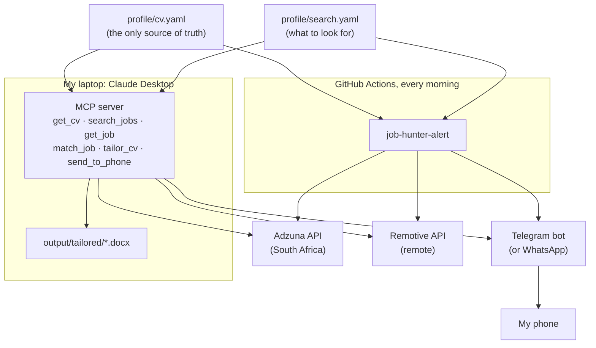

# job-hunter-mcp

My job search assistant. It does three things:

1. **Finds jobs that fit my CV**: South African jobs from [Jooble](https://jooble.org) and
   [Adzuna](https://www.adzuna.co.za) (each needs an API key; see setup), and remote jobs open to
   South Africa from [Remotive](https://remotive.com).
   Each job gets a 0–100 score with the skills it wants that my CV has, and the ones it lacks.
2. **Tailors my CV to a job** in Claude Desktop and saves it as a Word file. It
   reorders, rewords and highlights what is **already in my CV**, and refuses to add
   anything that isn't (a skill, a number, a technology).
3. **Sends a Telegram alert every morning** with the best new matches, from a
   scheduled GitHub Actions workflow. WhatsApp is supported too, but Meta requires a
   verified business for it (see step 4).

> **This repository is public on purpose.** `profile/cv.yaml` includes my contact
> details so employers can reach me. API keys and tokens never go in the code: they
> live in GitHub secrets and in my local Claude Desktop config. Because Actions logs of a
> public repository are public too, the daily alert keeps job details out of them and
> sends them only to my phone.

## How it fits together



## The MCP tools

| Tool | What it does |
| --- | --- |
| `get_cv` | The master CV with ids for every bullet (`e1.r2.b3` = job 1, role 2, bullet 3; `p1` = project 1). |
| `search_jobs` | Searches Jooble, Adzuna and/or Remotive (saved searches, or your own query) and ranks the results against the CV. |
| `get_job` | Full details of a job from the last search. |
| `match_job` | Paste any job description (LinkedIn included): score, skills you have and lack, and your most relevant bullets and projects. |
| `tailor_cv` | Builds a tailored CV and saves it to `output/tailored/`. Rejects skills, technologies or numbers that are not in your CV. |
| `send_to_phone` | Sends a message to your phone through Telegram (and WhatsApp, if set up). |

Things to ask Claude once it is connected:

- *"Search for platform engineer jobs and show me the five best fits."*
- *"Here's a job advert: [paste]. How well do I fit, and what am I missing?"*
- *"Tailor my CV for this job."*
- *"Send the shortlist to my phone."*

## Setup

### 1. Claude Desktop on your laptop

1. Install [uv](https://docs.astral.sh/uv/getting-started/installation/) (it also installs Python for you).
   Windows PowerShell: `powershell -ExecutionPolicy ByPass -c "irm https://astral.sh/uv/install.ps1 | iex"`
2. Clone this repository. On Windows, [GitHub Desktop](https://desktop.github.com/) is the
   easiest way; or `git clone https://github.com/BeaconNicolas/job-hunter-mcp.git`.
3. In the repository folder, run `uv sync` once.
4. Open Claude Desktop → **Settings → Developer → Edit Config**, and add:

   ```json
   {
     "mcpServers": {
       "job-hunter": {
         "command": "uv",
         "args": ["--directory", "C:\\Users\\YOU\\job-hunter-mcp", "run", "job-hunter-mcp"],
         "env": {
           "ADZUNA_APP_ID": "",
           "ADZUNA_APP_KEY": "",
           "TELEGRAM_BOT_TOKEN": "",
           "TELEGRAM_CHAT_ID": ""
         }
       }
     }
   }
   ```

   Use your own folder path (on a Mac, something like `/Users/you/job-hunter-mcp`).
   Fill the values in as you get them (steps 2 and 3); empty ones are simply skipped.
   WhatsApp settings (`WHATSAPP_TOKEN`, `WHATSAPP_PHONE_NUMBER_ID`, `WHATSAPP_TO`) can be
   added the same way if you use WhatsApp.
   If Claude Desktop says it cannot find `uv`, put the full path instead
   (`where uv` on Windows, `which uv` on a Mac).
5. Restart Claude Desktop. The tools appear under the **+** / tools menu.

Tailored CVs are saved in `output/tailored/` inside the repository folder, with a
`.yaml` record of exactly what changed. `output/` is ignored by git.

### 2. Adzuna API key (South African jobs)

1. Register at [developer.adzuna.com](https://developer.adzuna.com/) (use: *Personal job search*)
   and click the activation link in the email.
2. Copy the **Application ID** and **Application key** from **Dashboard → API Access Details**.

**Cost:** without a card, Adzuna gives **25 test calls in total**. Full access is £8 a month
(5,000 calls a month, 500 a day). To make the test calls last, the default search is one call
per run (`any_of` in `profile/search.yaml`), and each `search_jobs` call in Claude uses one.
When the calls run out, Adzuna answers with an error, and the alert reports it and carries on
with Remotive.

Without a key, the tools still search Remotive (remote jobs) and say that Adzuna was skipped.

### 2b. Jooble API key (more South African jobs, free on request)

1. Request a key with the form at [jooble.org/api/about](https://jooble.org/api/about). Describe it
   honestly, e.g. "a personal tool that searches jobs matching my CV and sends me a daily summary".
2. Jooble emails the key after a review. Save it as the GitHub secret `JOOBLE_API_KEY` (and, for
   Claude Desktop, in the config's `env`).

Searches are set under `jooble:` in `profile/search.yaml` (each keyword search is one call per
run). If Jooble's email names a different address for your country, put its host name in
`jooble.host`.

### 3. Telegram bot (free; recommended)

1. In Telegram, search for **@BotFather** (the official one has a blue tick) and tap **Start**.
2. Send `/newbot`. Give it a name, e.g. `Job Hunter Alerts`, and a username ending in `bot`,
   e.g. `beacon_jobhunter_bot`. BotFather replies with a **token** like `123456789:AA…`.
   Treat it like a password.
3. Open your new bot (BotFather's message links to it), tap **Start** and send it "hi".
4. Save the token as the GitHub secret `TELEGRAM_BOT_TOKEN` (step 5's table), then run
   **Actions → Find my Telegram chat ID → Run workflow**. Your bot replies in Telegram with
   your **chat ID**; save it as the secret `TELEGRAM_CHAT_ID`. (The ID is never printed in the
   public logs.) On a laptop you can instead run `uv run job-hunter-telegram-id` with
   `TELEGRAM_BOT_TOKEN` set.

   Avoid third-party "user info" bots for this: some copycats ask you to join channels first.

Only you can talk to your bot, and Telegram costs nothing, with no 24-hour rule.

### 4. WhatsApp (optional; Meta WhatsApp Cloud API)

**Heads-up:** Meta may lock new WhatsApp Business accounts of unverified businesses
(error 131031, "Business Account locked"), even for the free test number. Verification needs
official business documents. Without a registered business, use Telegram.

1. Go to [developers.facebook.com](https://developers.facebook.com/), **My Apps → Create App**,
   and choose the use case for connecting with customers on WhatsApp. Create or pick a
   business portfolio when asked.
2. In the app, open **WhatsApp → API Setup**. Meta gives you a test business phone number.
   Note the **Phone number ID**. Under **To**, add your own number (+27 …) and confirm the
   code WhatsApp sends you.
3. **A permanent token** (the one on the API Setup page expires after 24 hours):
   [business.facebook.com](https://business.facebook.com/) → **Settings → Users → System users →
   Add** (admin) → **Assign assets**: the app (full control) and the WhatsApp account →
   **Generate token** with `whatsapp_business_messaging` and `whatsapp_business_management`,
   expiry **Never**. Copy it somewhere safe; Meta shows it once.
4. **The alert template.** WhatsApp only lets a business message you first with an approved
   template. In [WhatsApp Manager](https://business.facebook.com/wa/manage/message-templates/) →
   **Message templates → Create template**:
   - Category: **Utility**. Name: `job_alert`. Language: **English**.
   - Body:
     ```
     Good morning! I found {{1}} new jobs that match your CV: {{2}} Reply here if you want to follow up.
     ```
   - Sample values: `3` and `1) Cloud Engineer - Acme (Johannesburg), 82% match: https://example.com`.
   - Submit. Approval usually takes minutes to a few hours.
5. From your phone, send any message to the business number once. That also opens a
   24-hour window in which `send_to_phone` can send you free WhatsApp text.

Meta charges per template message delivered (the rate depends on the category and
country); check [Meta's pricing page](https://developers.facebook.com/docs/whatsapp/pricing)
for current South African rates. One alert a day is a small amount.

### 5. GitHub secrets and variables (daily alert)

In this repository: **Settings → Secrets and variables → Actions**.

| Name | Type | Value |
| --- | --- | --- |
| `ADZUNA_APP_ID` | Secret | Adzuna Application ID |
| `ADZUNA_APP_KEY` | Secret | Adzuna Application key |
| `JOOBLE_API_KEY` | Secret | Jooble API key |
| `TELEGRAM_BOT_TOKEN` | Secret | The bot token from @BotFather |
| `TELEGRAM_CHAT_ID` | Secret | Your chat ID (step 3) |
| `WHATSAPP_TOKEN` | Secret | Optional: permanent system-user token |
| `WHATSAPP_PHONE_NUMBER_ID` | Secret | Phone number ID from API Setup |
| `WHATSAPP_TO` | Secret | Your number with country code, digits only: `27…` |
| `WHATSAPP_TEMPLATE` | Variable | `job_alert` |
| `WHATSAPP_TEMPLATE_LANG` | Variable | The template's language code, e.g. `en` or `en_US` |
| `ALERT_DETAILS_IN_LOGS` | Variable | Leave unset. `true` shows job titles and missing skills in the Actions logs, which anyone can read while the repository is public. |

Then **Actions → Daily job alert → Run workflow**, first with **dry run** ticked (it searches
and reports how many jobs it would send, and sends nothing), then without. After that it runs
every morning at about 06:20 South African time. Each job is sent only once. To see the full
list of matches with scores, run `uv run job-hunter-alert --dry-run` on your laptop or ask
Claude to `search_jobs`.

Costs: GitHub Actions is free for public repositories, and Remotive's API is free. Adzuna
gives 25 test calls, then costs £8 a month (see step 2).

## Editing the CV and the search

- **`profile/cv.yaml`** is the master CV. Add new experience, skills or achievements here
  first; nothing can appear in a tailored CV unless it is in this file. `tags` on bullets
  help matching. `include: false` hides an item from the default CV while keeping it
  available for tailoring.
- **`profile/search.yaml`** holds the job titles to favour, titles to skip, the minimum
  score for alerts, the Adzuna searches (each one is an API call per run) and the
  Remotive categories.
- Render the master CV to Word: `uv run job-hunter-render profile/cv.yaml output/CV.docx`.

## How matching works

Both the job advert and the CV are scanned for about 100 known technologies
(`src/job_hunter/vocabulary.py`). The score is 55% skill coverage (the share of the job's
technologies that your CV has, counting at least three, so one matching skill is not "full
coverage") and 45% title fit (a target title from `search.yaml`, or at least a
cloud/DevOps/platform title), minus 15 points when the advert asks for clearly more years of
experience than you have. Jobs whose title is outside your field are capped at 40, below the
alert threshold. Missing skills are always listed, so gaps stay visible.

Adzuna only returns a short part of each advert, so its scores are rougher. For an
important application, paste the full advert into `match_job`.

## How tailoring stays honest

`tailor_cv` accepts a new summary and headline, a new order and grouping of your
existing skills, the order of bullets, rewordings of bullets, and which projects to show. It
rejects the whole request, saving nothing, when:

- a skill is not already in the CV;
- the summary, headline or a reworded bullet mentions a technology the CV doesn't;
- a reworded bullet contains a number its original didn't (and the summary may only use
  numbers from the CV, plus your years of experience);
- an id doesn't exist.

Rewording that stays true is fine: using the advert's vocabulary for something you really did.

## Development

```bash
uv sync
uv run pytest          # no network or secrets needed: the APIs are mocked
uv run ruff check . && uv run ruff format --check .
uv run job-hunter-alert --dry-run
```
