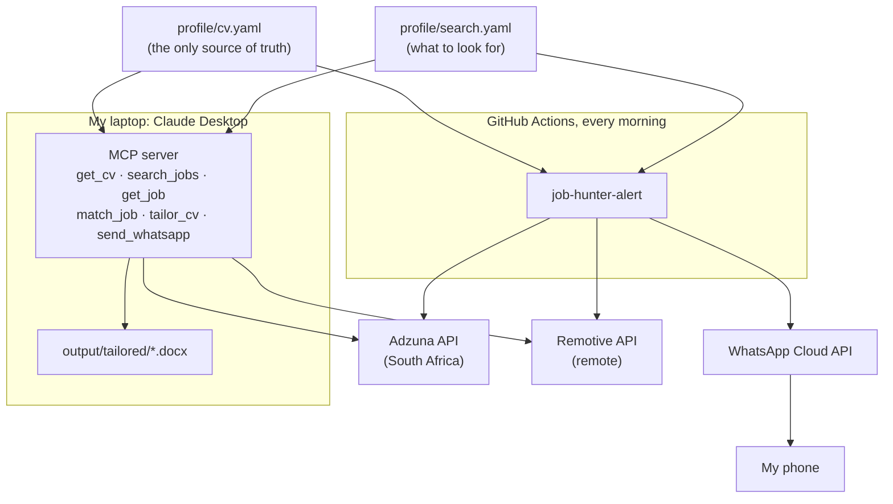

# job-hunter-mcp

My job search assistant. It does three things:

1. **Finds jobs that fit my CV**: South African jobs from [Adzuna](https://www.adzuna.co.za)
   and remote jobs open to South Africa from [Remotive](https://remotive.com).
   Each job gets a 0–100 score with the skills it wants that my CV has, and the ones it lacks.
2. **Tailors my CV to a job** in Claude Desktop and saves it as a Word file. It
   reorders, rewords and highlights what is **already in my CV**, and refuses to add
   anything that isn't (a skill, a number, a technology).
3. **Sends a WhatsApp alert every morning** with the best new matches, from a
   scheduled GitHub Actions workflow.

> **This repository is public on purpose.** `profile/cv.yaml` includes my contact
> details so employers can reach me. API keys and tokens never go in the code: they
> live in GitHub secrets and in my local Claude Desktop config. Because Actions logs of a
> public repository are public too, the daily alert keeps job details out of them and
> sends them only to WhatsApp.

## How it fits together



## The MCP tools

| Tool | What it does |
| --- | --- |
| `get_cv` | The master CV with ids for every bullet (`e1.r2.b3` = job 1, role 2, bullet 3; `p1` = project 1). |
| `search_jobs` | Searches Adzuna and/or Remotive (saved searches, or your own query) and ranks the results against the CV. |
| `get_job` | Full details of a job from the last search. |
| `match_job` | Paste any job description (LinkedIn included): score, skills you have and lack, and your most relevant bullets and projects. |
| `tailor_cv` | Builds a tailored CV and saves it to `output/tailored/`. Rejects skills, technologies or numbers that are not in your CV. |
| `send_whatsapp` | Sends a message to your WhatsApp (free text works within 24 hours of your last message to the business number). |

Things to ask Claude once it is connected:

- *"Search for platform engineer jobs and show me the five best fits."*
- *"Here's a job advert: [paste]. How well do I fit, and what am I missing?"*
- *"Tailor my CV for this job."*
- *"Send the shortlist to my WhatsApp."*

## Setup

### 1. Claude Desktop on your laptop

1. Install [uv](https://docs.astral.sh/uv/getting-started/installation/) (it also installs Python for you).
   Windows PowerShell: `powershell -ExecutionPolicy ByPass -c "irm https://astral.sh/uv/install.ps1 | iex"`
2. Clone this repository. On Windows, [GitHub Desktop](https://desktop.github.com/) is the
   easiest way; or `git clone https://github.com/BeaconNicolas/job-hunter-mcp.git`.
3. In the repository folder, run `uv sync` once.
4. Open Claude Desktop → **Settings → Developer → Edit Config**, and add:

   ```json
   {
     "mcpServers": {
       "job-hunter": {
         "command": "uv",
         "args": ["--directory", "C:\\Users\\YOU\\job-hunter-mcp", "run", "job-hunter-mcp"],
         "env": {
           "ADZUNA_APP_ID": "",
           "ADZUNA_APP_KEY": "",
           "WHATSAPP_TOKEN": "",
           "WHATSAPP_PHONE_NUMBER_ID": "",
           "WHATSAPP_TO": ""
         }
       }
     }
   }
   ```

   Use your own folder path (on a Mac, something like `/Users/you/job-hunter-mcp`).
   Fill the values in as you get them (steps 2 and 3); empty ones are simply skipped.
   If Claude Desktop says it cannot find `uv`, put the full path instead
   (`where uv` on Windows, `which uv` on a Mac).
5. Restart Claude Desktop. The tools appear under the **+** / tools menu.

Tailored CVs are saved in `output/tailored/` inside the repository folder, with a
`.yaml` record of exactly what changed. `output/` is ignored by git.

### 2. Adzuna API key (free)

1. Register at [developer.adzuna.com](https://developer.adzuna.com/) and create an application.
2. Copy the **Application ID** and **Application key**.

Without a key, the tools still search Remotive (remote jobs) and say that Adzuna was skipped.

### 3. WhatsApp (Meta WhatsApp Cloud API)

1. Go to [developers.facebook.com](https://developers.facebook.com/), **My Apps → Create App**,
   and choose the use case for connecting with customers on WhatsApp. Create or pick a
   business portfolio when asked.
2. In the app, open **WhatsApp → API Setup**. Meta gives you a test business phone number.
   Note the **Phone number ID**. Under **To**, add your own number (+27 …) and confirm the
   code WhatsApp sends you.
3. **A permanent token** (the one on the API Setup page expires after 24 hours):
   [business.facebook.com](https://business.facebook.com/) → **Settings → Users → System users →
   Add** (admin) → **Assign assets**: the app (full control) and the WhatsApp account →
   **Generate token** with `whatsapp_business_messaging` and `whatsapp_business_management`,
   expiry **Never**. Copy it somewhere safe; Meta shows it once.
4. **The alert template.** WhatsApp only lets a business message you first with an approved
   template. In [WhatsApp Manager](https://business.facebook.com/wa/manage/message-templates/) →
   **Message templates → Create template**:
   - Category: **Utility**. Name: `job_alert`. Language: **English**.
   - Body:
     ```
     Good morning! I found {{1}} new jobs that match your CV: {{2}} Reply here if you want to follow up.
     ```
   - Sample values: `3` and `1) Cloud Engineer - Acme (Johannesburg), 82% match: https://example.com`.
   - Submit. Approval usually takes minutes to a few hours.
5. From your phone, send any message to the business number once. That also opens a
   24-hour window in which `send_whatsapp` can send you free text.

Meta charges per template message delivered (the rate depends on the category and
country); check [Meta's pricing page](https://developers.facebook.com/docs/whatsapp/pricing)
for current South African rates. One alert a day is a small amount.

### 4. GitHub secrets and variables (daily alert)

In this repository: **Settings → Secrets and variables → Actions**.

| Name | Type | Value |
| --- | --- | --- |
| `ADZUNA_APP_ID` | Secret | Adzuna Application ID |
| `ADZUNA_APP_KEY` | Secret | Adzuna Application key |
| `WHATSAPP_TOKEN` | Secret | Permanent system-user token |
| `WHATSAPP_PHONE_NUMBER_ID` | Secret | Phone number ID from API Setup |
| `WHATSAPP_TO` | Secret | Your number with country code, digits only: `27…` |
| `WHATSAPP_TEMPLATE` | Variable | `job_alert` |
| `WHATSAPP_TEMPLATE_LANG` | Variable | The template's language code, e.g. `en` or `en_US` |
| `ALERT_DETAILS_IN_LOGS` | Variable | Leave unset. `true` shows job titles and missing skills in the Actions logs, which anyone can read while the repository is public. |

Then **Actions → Daily job alert → Run workflow**, first with **dry run** ticked (it searches
and reports how many jobs it would send, and sends nothing), then without. After that it runs
every morning at about 06:20 South African time. Each job is sent only once. To see the full
list of matches with scores, run `uv run job-hunter-alert --dry-run` on your laptop or ask
Claude to `search_jobs`.

Costs: GitHub Actions is free for public repositories. Adzuna's and Remotive's APIs are free.

## Editing the CV and the search

- **`profile/cv.yaml`** is the master CV. Add new experience, skills or achievements here
  first; nothing can appear in a tailored CV unless it is in this file. `tags` on bullets
  help matching. `include: false` hides an item from the default CV while keeping it
  available for tailoring.
- **`profile/search.yaml`** holds the job titles to favour, titles to skip, the minimum
  score for WhatsApp, the Adzuna searches and the Remotive categories.
- Render the master CV to Word: `uv run job-hunter-render profile/cv.yaml output/CV.docx`.

## How matching works

Both the job advert and the CV are scanned for about 100 known technologies
(`src/job_hunter/vocabulary.py`). The score is 55% skill coverage (the share of the job's
technologies that your CV has) and 45% title fit (a target title from `search.yaml`, or at
least a cloud/DevOps/platform title), minus 15 points when the advert asks for clearly more
years of experience than you have. Missing skills are always listed, so gaps stay visible.

Adzuna only returns a short part of each advert, so its scores are rougher. For an
important application, paste the full advert into `match_job`.

## How tailoring stays honest

`tailor_cv` accepts a new summary and headline, a new order and grouping of your
existing skills, the order of bullets, rewordings of bullets, and which projects to show. It
rejects the whole request, saving nothing, when:

- a skill is not already in the CV;
- the summary, headline or a reworded bullet mentions a technology the CV doesn't;
- a reworded bullet contains a number its original didn't (and the summary may only use
  numbers from the CV, plus your years of experience);
- an id doesn't exist.

Rewording that stays true is fine: using the advert's vocabulary for something you really did.

## Development

```bash
uv sync
uv run pytest          # no network or secrets needed: the APIs are mocked
uv run ruff check . && uv run ruff format --check .
uv run job-hunter-alert --dry-run
```
